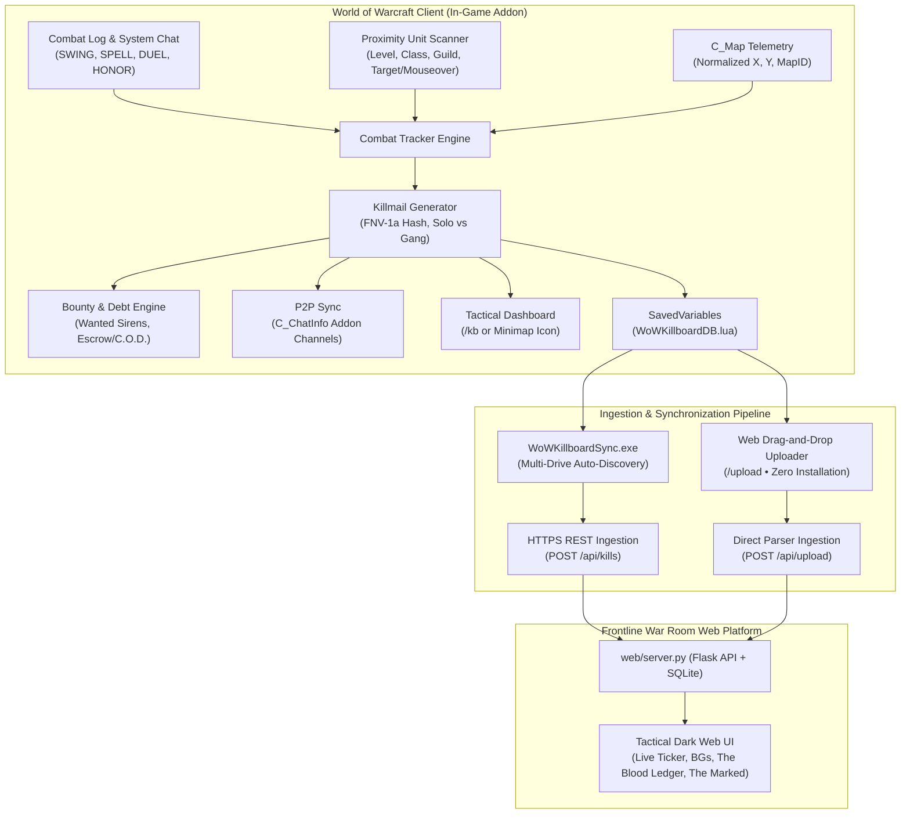

# WoW Killboard — Frontline War Room

[](CHANGELOG.md)
[](https://github.com/dagariane-commits/WoW_Killboard/actions/workflows/ci.yml)
[](https://github.com/dagariane-commits/WoW_Killboard/actions/workflows/codeql.yml)
[](docs/TAINT_AND_COMPATIBILITY.md)
[](docs/TAINT_AND_COMPATIBILITY.md)
[](dist/WoWKillboardSync.exe)
[](LICENSE)

**WoW Killboard** is an independent, community-driven combat telemetry suite and killboard designed for World of Warcraft. It provides real-time in-game battle logging, certified 1v1 duel validation, battleground scoreboards, open-world blood bounties, and wilderness hazard telemetry across **World of Warcraft: Forever**, **Classic Era**, **Anniversary**, and modern **Retail** clients.

Engineered with strict zero-taint standards, WoW Killboard runs anonymously inside Blizzard's Lua sandbox to deliver high-performance combat intelligence without causing interface lockups, frame stutters, or "Action Blocked" combat restrictions.

> [!NOTE]
> **Active Beta Status**: Live testing is currently focused in **WoW Forever Beta**. The codebase is engineered for cross-client parity across **Classic Era**, **Anniversary**, and **Retail**, with multi-flavor verification ongoing. Feedback, issue reports, and feature requests are actively welcomed to guide continued development.

---

## Technical Documentation & Wiki

Comprehensive technical documentation is maintained in the [`docs/`](docs/) directory:

- 📖 **[Master Technical Wiki](docs/README.md)** — Architectural index and developer portal.
- 🏛️ **[System Architecture Specification](docs/ARCHITECTURE.md)** — In-depth breakdown of the 3-tier model, data contracts, and FNV-1a hashing.
- ⚡ **[Beta Tester Quickstart Guide](docs/BETA_TESTER_QUICKSTART.md)** — 2-minute setup, in-game controls, and automated AI bug reporting.
- ⚔️ **[Combat Telemetry & Gang Engine](docs/COMBAT_ENGINE.md)** — 15-second sliding gang clustering, 1v1 duels, and BG scoreboard telemetry.
- 🩸 **[Blood Bounties & The Marked](docs/BOUNTY_SYSTEM.md)** — Execution contracts, strict open-world PvP gating, anti-win-trade rules, and debtor radar.
- 🛡️ **[Taint Security & Compatibility](docs/TAINT_AND_COMPATIBILITY.md)** — Complete guide to our zero-taint standard across all 4 WoW client flavors.
- 📊 **[Stress Testing & Performance Benchmarks](docs/STRESS_TESTING.md)** — Multi-tier load testing, parser benchmarking (7,200+ rec/s), and API concurrency.
- ☁️ **[Dedicated Linux VPS Deployment](docs/DEPLOYMENT_VPS.md)** — AWS Lightsail runbook, automated SSL/TLS via Caddy, and backup automation.
- 🗺️ **[Forward Strategic Roadmap](docs/ROADMAP.md)** — Phased roadmap covering public launch, guild war rooms, and ranked seasons.
- 🚀 **[Public Release & Distribution Playbook](docs/PUBLIC_RELEASE_PLAYBOOK.md)** — Guide for packaging, CurseForge/Wago distribution, and hosting.
- 📝 **[Semantic Version Change Log](CHANGELOG.md)** — Full changelog trail from initial prototype to v1.1.0 release.
- 🤝 **[Contributing Guidelines](CONTRIBUTING.md)** — Development standards and PR checklist for open-source contributors.
- ⚖️ **[Legal, Safety & Compliance Guide](docs/LEGAL_AND_COMPLIANCE.md)** — Authorship, Blizzard Add-on Policy compliance, zero PII, and anti-cheat safety.

---

## Architecture at a Glance

Because World of Warcraft addons operate in an isolated Lua sandbox without raw outbound socket capabilities, WoW Killboard operates across three synchronized tiers:



---

## Core Feature Highlights

### 1. In-Game Combat Addon (`Addon/WoWKillboard/`)
- **Blizzard-Style Overhanging Portrait Medallion**:
  - 60x60 circular player portrait docked at `TOPLEFT (-8, 8)` hanging naturally off the top-left corner in classic Blizzard UI fashion (`CharacterFrame` / `SpellBookFrame`).
  - Concentric 66x66 gold medallion bezel (`Textures/medallion_border.tga`) with overlapping 20x20 circular level badge (`BOTTOMRIGHT (2, -2)`).
- **Text-Only Sub-Bar Navigation**:
  - Clean, borderless text links (`Intel`, `Leaderboards`, `The Marked`, `Call to Arms`, `Danger Zones`) with dynamic hover highlighting and a 2px gold active underline accent (`bottomAccent`).
- **Contextual Page-Level Mode Filtering**:
  - Contextual Mode Filter Pills (`[ World ] [ BGs ] [ Duels ] [ Arenas ]`) mounted directly within the views where filtering operates (opposite category pills on the Leaderboard, and on the header strip of Recent Combat Intel).
- **Tactical Combat Feed & Zero-Truncation Layout**:
  - 18x18 ability cell displaying fatal blow and hazard spell icons with interactive tooltips on hover.
  - Generous column widths (168px combatants, +64px expanded zone width) preventing name, guild tag, or subzone ellipsis clipping.
- **Strict 3-Theme Architecture (`/kb theme`)**:
  - **WKB Theme (Default)**: 1:1 visual parity with `wowkillboard.com` (obsidian canvas `#040609`, brass borders `#947338`, elevated card panels `#0B0F17`).
  - **Classic Forever**: Authentic Blizzard dialog stone backdrops (`UI-DialogBox-Background`), beveled borders (`UI-DialogBox-Border`), and parchment accents.
  - **ElvUI Minimalist**: Dark slate frame (`#0A0A0A`), strict 1px flat borders, and white accent outlines.
- **1v1 Duel Match Engine & 15s Temporal Gang Clustering**:
  - Distinguishes certified 1v1 solo triumphs from group ganks using a 15-second sliding correlation window. Captures duel knockouts and forfeits via `CHAT_MSG_SYSTEM` with exact GPS coordinates.
- **The Blood Ledger: Bounties & The Marked (World PvP Only)**:
  - Declare in-game gold bounties (`/kb bounty <Target> <Gold>`) upon open-world killers.
  - Integrated anti-win-trade heuristics, delayed last-seen vicinity intel, and debtor warning sirens (`PlaySound(8959)`) when an Oathbreaker is near.
- **War Horn & Vanguard Manhunt (`/warhorn`)**:
  - Transmits emergency SOS distress calls with GPS coordinates to Guild, Party/Raid, and local channels.
  - Automatic 10-minute Auto-Invite squad listener (`whisper "invite"` or `"rally"`).
- **Deadly Hazards & Wilderness Elites**:
  - Dedicated PvE casualty tracking for world bosses and notorious elites (Hogger, Son of Arugal, Stitches) completely isolated from PvP leaderboards.
- **Strict Zero-Taint Security**:
  - 100% pure Lua widgets using `"BackdropTemplate"`, custom ESC key listeners, zero XML template inheritance, and strict `InCombatLockdown()` gating.

### 2. Desktop Ingestion Courier (`WoWKillboardSync.exe`)
- **Zero-Python Standalone Executable**: Single portable Windows binary requiring no runtime dependencies or configuration.
- **Multi-Drive Auto-Discovery**: Automatically locates active WoW installations and `SavedVariables` across drives `C:`, `D:`, and `E:`.
- **High-Speed Streaming Parser**: Rapid recursive-descent Lua tokenizer syncing combat records on `/reload` or game exit.

### 3. Frontline War Room Web Platform (`web/`)
- **Authoritative Realm Leaderboards**: Sortable standings across 4 timeframe intervals (`24h`, `7d`, `30d`, `All-Time`) with interactive column sorting and 9-class classic filtering.
- **Player & Guild Combat Dossiers**: Detailed match histories, solo kill ratios, damage/healing metrics, and historical guild affiliation timelines.
- **The Blood Ledger Outlaw Gallery**: Real-time top 10 most wanted bounties with character portraits, bounty pools, and last-seen zone telemetry.
- **Realm Player Armory Directory**: Complete character directory with Classic PvP Military Honor Ranks (Private to Grand Marshal / Scout to High Warlord) and KOS blacklist badges.
- **High-Concurrency SQLite WAL Engine**: Non-blocking concurrent reads and burst write throughput via Write-Ahead Logging and 10-second busy timeouts.
- **Zero-Barrier Web Uploader**: Direct drag-and-drop browser ingestion (`wowkillboard.com/upload`) for players who prefer not to run background software.
- **StreamBox Broadcaster HUD**: Transparent, auto-refreshing OBS Studio overlay (`/war-hud/<CharacterName>`) for content creators.
- **100% Ad-Free Experience**: Zero commercial banners, tracking scripts, or ad networks. Supported entirely through community contributions.

---

## Directory Layout

```text
WoW_Killboard/
├── Addon/
│   └── WoWKillboard/
│       ├── WoWKillboard.toc         # Multi-client TOC descriptor (11506, 11507, 110007, 16001)
│       ├── Config.lua               # Constants, sound IDs, class colors
│       ├── Utils.lua                # FNV-1a hash generator, formatters, GPS resolution
│       ├── UnitScanner.lua          # Proximity level/class/guild cache & KOS sirens
│       ├── CombatTracker.lua        # Combat log, gang clustering, duel/BG telemetry
│       ├── Killmail.lua             # Standardized killmail model & persistence
│       ├── BountyEngine.lua         # Bounties, anti-win-trade, debtor sirens
│       ├── Sync.lua                 # P2P Addon networking (C_ChatInfo)
│       ├── Reinforcements.lua       # SOS distress beacons, auto-invite party engine
│       ├── IntelScanner.lua         # Tactical Intel & enemy recon spotting (/spot, /scout)
│       ├── Leaderboard.lua          # Multi-mode rankings (All / World / BG / Duel)
│       ├── UI.lua                   # 100% taint-free dark dashboard (/kb)
│       └── Core.lua                 # Lifecycle, slash commands, minimap button

├── docs/                            # Comprehensive Technical Wiki
│   ├── README.md                    # Master Wiki index & portal
│   ├── ARCHITECTURE.md              # 3-tier architectural specification
│   ├── COMBAT_ENGINE.md             # Combat logging & gang clustering details
│   ├── BOUNTY_SYSTEM.md             # Escrow, debt ledger & debtor radar
│   ├── TAINT_AND_COMPATIBILITY.md   # Zero-taint philosophy & client matrix
│   ├── ROADMAP.md                   # Strategic forward plan (Phases 1-4)
│   └── PUBLIC_RELEASE_PLAYBOOK.md   # Packaging & distribution guide
├── sync/
│   └── watcher.py                   # SavedVariables file watcher & Lua parser
├── web/
│   ├── server.py                    # Flask REST API & SQLite persistence
│   └── static/
│       ├── index.html               # Responsive web interface
│       ├── app.js                   # Reactive state controller
│       └── style.css                # Dark zKillboard styling
├── tests/
│   ├── test_pipeline.py             # End-to-end pipeline test suite
│   ├── test_watcher_parser.py       # Lua parser unit tests
│   └── validate_lua.py              # Automated Lua syntax & bracket validator
├── CHANGELOG.md                     # Semantic version change log
├── CONTRIBUTING.md                  # Open-source contribution guidelines
├── WoWKillboardSync.exe             # Pre-compiled standalone sync binary (12.3 MB)
└── WoWKillboard-v1.1.0.zip          # Production-ready addon release package
```

---

## Quickstart Guide

### 1. In-Game Addon Installation
1. Download [`WoWKillboard-v1.1.0.zip`](WoWKillboard-v1.1.0.zip) and extract it into your World of Warcraft AddOns directory:
   - **Forever Beta**: `World of Warcraft/_classic_beta_/Interface/AddOns/WoWKillboard`
   - **Classic Era**: `World of Warcraft/_classic_era_/Interface/AddOns/WoWKillboard`
   - **Anniversary**: `World of Warcraft/_anniversary_/Interface/AddOns/WoWKillboard`
   - **Modern Retail**: `World of Warcraft/_retail_/Interface/AddOns/WoWKillboard`
2. Start WoW and ensure **WoW Killboard** is checked in your AddOns menu.
3. In-game commands:
   - `/killboard` or `/wowkb` — Open the Frontline War Room dashboard.
   - `/killboard alerts` or `/wowkb alerts` — Open Combat Alerts & Radar settings (or click `[Alerts]` button in header).
   - `/killboard move` or `/wowkb move` — Unlock and reposition Kill Banner anywhere on screen.
   - `/killboard test` or `/wowkb test` — Preview Kill Banner with audio and raid warning.
   - `/killboard theme` — Switch between Classic WoW and ElvUI Minimalist themes.
   - `/killboard channel [show|hide]` or `/kbchannel` — Toggle open-world casualty stream directly in your General chat window.
   - `/killboard stream [both|chat|banner|off]` or `/kbstream` — Set alert delivery mode: `both` (heads-up banner + live chat log), `chat` (silent chat stream only), `banner` (heads-up banner only), or `off` (muted).
   - `/killboard chat` or `/kb chat` — Toggle public chat broadcasts (/yell) for open world defense (Opt-in).
   - `/killboard testchat` or `/kb testchat` — Preview standardized military chat telemetry (Formats A, B, C).
   - `/warhorn` or `/kbrally` — Sound the War Horn (open-world emergency distress & auto-invite rally).
   - `/killboard stats` — View current session damage, healing, kills, and K/D.
   - `/testnet` or `/kb testnet` — Broadcast a simulated casualty across the realm network to test alerts on any player with the addon (0 database writes).
   - `/kb net` or `/kb channel` — Inspect live realm network connection and channel diagnostics.
   - `/kb welcome [reset|on|off]` or `/kb beta` — Open or toggle the Early Beta Preview & Community Feedback guide on login.
   - `/kb changelog` or `/kb update` — Open What's New & Version Changelog modal.
   - `/armory [Name]` — Direct in-game character combat dossier lookup.
   - `/kb claim <code>` — Register web character ownership verification code (followed by `/reload`).
   - `/killboard bounty <Name> <Gold>` — Declare a blood bounty upon an enemy player (open world only).
   - `/kb bug <description>` or `/kb report` — Submit in-game telemetry & bug dispatch directly to the AI Diagnostician (or click `[Report Bug]` in header).
   - `/killboard reset` — Clear local kill database.

### 2. Synchronizing with the Web Killboard

#### Method A: Web Drag-and-Drop (Zero Installation • Recommended)
You do not need to install or run any executable on your PC:
1. Open the [WoW Killboard Web Uploader](https://wowkillboard.com/upload) in your browser.
2. Drag and drop your `SavedVariables\WoWKillboard.lua` file into the upload zone (located in `WTF\Account\<AccountName>\SavedVariables\WoWKillboard.lua`).
3. Your combat history, bounties, and leaderboards update immediately.

#### Method B: Optional Desktop Companion (`WoWKillboardSync.exe`)
For players who prefer automated background syncing without manually dragging files:
1. Download [`WoWKillboardSync.exe`](WoWKillboardSync.exe).
2. The companion monitors `SavedVariables/WoWKillboard.lua` across drives C:, D:, and E: and automatically syncs when you `/reload` or log out of WoW.
3. **Security & SmartScreen Notice**: Because the companion is an independent open-source tool without an enterprise certificate, Windows may prompt on first run:
   - **Windows Defender SmartScreen**: Click **More info** → **Run anyway**.
   - **Windows 11 Smart App Control**: If blocked with no "Run anyway" button, right-click `WoWKillboardSync.exe` in Downloads → select **Properties** → check the **"Unblock"** checkbox at the bottom → click **OK**, then double-click to launch.
   - The companion is fully open-source, contains zero shell execution, and has been verified clean across 66+ security vendors on [VirusTotal](https://www.virustotal.com).

### 3. Running the Local Web Server (For Developers)
```bash
# Install dependencies
pip install -r requirements.txt

# Start the Flask web platform
python web/server.py
```
Open **`http://localhost:8080`** in your browser.

### 4. Running Automated Tests
```bash
# Validate all 13 Lua files for syntax compliance
python tests/validate_lua.py

# Run complete end-to-end test suite
python -m unittest discover tests
```

---

## Legal, Safety & Privacy Compliance

- **Sole Authorship & Ownership**: Architected and created by **Dagariane**.
- **Blizzard Add-on Policy Compliant**: 100% free of charge, open-source visible code, zero in-game commercial ads, zero in-game donation solicitations, and zero real-money trading (RMT).
- **Anti-Cheat & Warden Safe**: Operates purely within Blizzard's sandboxed Lua environment. Zero process memory reading/writing, zero DLL injection, and zero executable patching. The desktop sync agent reads plain-text SavedVariables files from disk (identical to *Warcraft Logs* and *Raider.IO*).
- **Zero PII (Personally Identifiable Information)**: Does not collect, transmit, or store real names, emails, IP addresses, BattleTags, account credentials, or hardware IDs.
- **Trademark Notice**: *World of Warcraft, Warcraft, Battle.net, and Blizzard Entertainment are trademarks or registered trademarks of Blizzard Entertainment, Inc. in the U.S. and/or other countries. WoW Killboard is not affiliated with, authorized by, sponsored by, or endorsed by Blizzard Entertainment, Inc.*
- Detailed compliance audit: See [`docs/LEGAL_AND_COMPLIANCE.md`](docs/LEGAL_AND_COMPLIANCE.md).

---

## License

This project is licensed under the GNU General Public License v3.0 (GPLv3). Copyright (c) 2026 Dagariane. See [LICENSE](LICENSE) for details.
